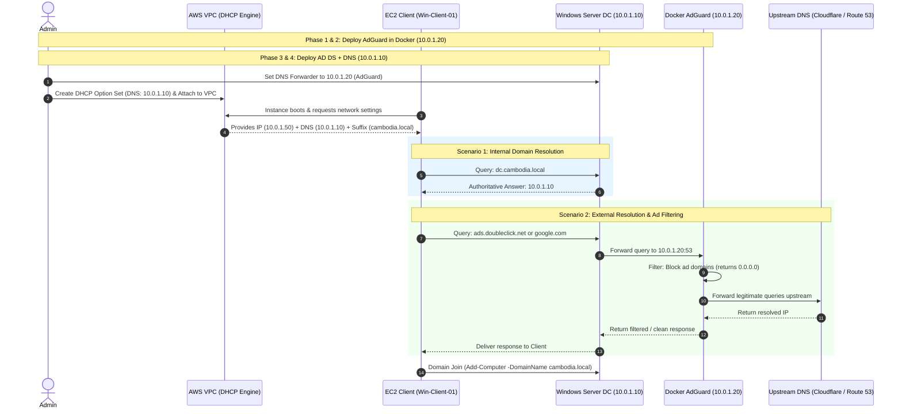

# Full Implementation Guide: Windows Active Directory, DNS & AdGuard Home (Docker) on AWS

This guide provides complete, production-grade instructions to build the end-to-end environment on AWS:
1. Setting up the AWS VPC and Subnets.
2. Launching and configuring an **AdGuard Home** container using Docker on Linux.
3. Deploying a Windows Server EC2 instance as an **Active Directory Domain Controller and DNS Server**.
4. Linking Windows DNS Forwarders to the AdGuard Home Docker instance (**Architecture A**).
5. Setting up **AWS VPC DHCP Option Sets** to automatically distribute the setup to client instances.
6. Verifying domain join, DNS resolution, and ad-filtering from a client machine.

---

## Architecture Flow Overview



---

## Phase 1: AWS VPC & Network Infrastructure Setup

### 1. Create the VPC
1. Open the **AWS VPC Console** ➔ **Your VPCs** ➔ click **Create VPC**.
2. Select **VPC only**:
   * **Name tag:** `lab-ad-vpc`
   * **IPv4 CIDR block:** `10.0.0.0/16`
3. Click **Create VPC**.

### 2. Create the Subnet
1. In the VPC Console, click **Subnets** (left menu) ➔ click **Create subnet**.
2. Settings:
   * **VPC:** Select `lab-ad-vpc`
   * **Subnet name:** `lab-private-subnet-a`
   * **Availability Zone:** Choose any (e.g., `ap-southeast-1a`)
   * **IPv4 CIDR block:** `10.0.1.0/24`
3. Click **Create subnet**.

### 3. Configure Internet Gateway & Route Table (CRITICAL for SSH & RDP Connectivity!)

> [!IMPORTANT]
> **Why this step is mandatory for SSH:**  
> When you create a custom VPC and subnet manually in AWS, they are created **completely isolated from the internet**. Even if your EC2 instance has a Public IP address, your SSH and RDP connections will **fail with "Connection timed out"** unless you attach an Internet Gateway and explicitly associate the subnet to the route table!

#### Step 3.1: Create & Attach the Internet Gateway
1. In the **AWS VPC Console**, click **Internet gateways** (left menu).
2. Click the orange **Create internet gateway** button.
3. **Name tag:** `lab-igw` ➔ click **Create internet gateway**.
4. In the green banner at the top, click **Actions** ➔ select **Attach to VPC**.
5. Select your VPC (`lab-ad-vpc`) ➔ click **Attach internet gateway**.

#### Step 3.2: Add the `0.0.0.0/0` Internet Route
1. In the left menu of the VPC Console, click **Route tables**.
2. Select the route table associated with `lab-ad-vpc` (e.g., `rtb-xxxxxx`).
3. In the lower pane, click the **Routes** tab ➔ click **Edit routes**.
4. Click **Add route**:
   * **Destination:** `0.0.0.0/0`
   * **Target:** Click the dropdown ➔ select **Internet Gateway** ➔ choose your `lab-igw`.
5. Click **Save changes**.

#### Step 3.3: Explicit Subnet Association (The Step That Fixes the Timeout!)
1. In that same Route Table page, click the **Subnet associations** tab.
2. Scroll to the section **Subnets without explicit associations** and click the **Edit subnet associations** button.
3. Check the checkbox next to your subnet: ✅ **`lab-private-subnet-a`** (`10.0.1.0/24`).
4. Click **Save associations**.

*Now your subnet is a fully routable public subnet capable of receiving SSH (port 22) and RDP (port 3389) traffic without any timeouts!*

---

## Phase 2: Deploy AdGuard Home on Docker (Linux EC2)

### 1. Create AdGuard Security Group (`adguard-docker-sg`)

> [!CAUTION]
> **Inbound vs. Outbound Rules Warning & AWS Naming Rule:**  
> 1. In AWS, Security Group names **cannot begin with `sg-`** (as `sg-` is reserved for AWS system IDs). Use **`adguard-docker-sg`**.  
> 2. Add the port rules below under **Inbound rules** (traffic coming *into* your server), **NOT Outbound rules**!  
> 3. Leave **Outbound rules** at the AWS default (`All traffic` ➔ `0.0.0.0/0`) so your server can access the internet to download Docker and resolve upstream DNS.

1. Open **EC2 Console** ➔ **Network & Security** (left menu) ➔ **Security Groups** ➔ click **Create security group**.
2. **Basic details:**
   * **Security group name:** `adguard-docker-sg`
   * **Description:** `Allow DNS from DC and Web UI / SSH from Admin`
   * **VPC:** Select `lab-ad-vpc` (click the `X` on the default VPC first, then select your VPC).
3. **Inbound rules** (Click **Add rule** for each row below):

| Type | Protocol | Port Range | Source Type | Source | Description |
| :--- | :--- | :--- | :--- | :--- | :--- |
| **Custom UDP** | UDP | `53` | Custom | `10.0.1.10/32` | DNS queries from Windows DC |
| **Custom TCP** | TCP | `53` | Custom | `10.0.1.10/32` | DNS queries from Windows DC |
| **Custom TCP** | TCP | `3000` | My IP / Anywhere | `My IP` (or `0.0.0.0/0`) | AdGuard Initial Setup Wizard |
| **Custom TCP** | TCP | `80` | My IP / Anywhere | `My IP` (or `0.0.0.0/0`) | AdGuard Web Admin Dashboard |
| **SSH** | TCP | `22` | My IP / Anywhere | `My IP` (or `0.0.0.0/0`) | SSH Admin Access |

> [!TIP]
> If your home or mobile internet IP address changes frequently, set SSH (22), Port 3000, and Port 80 to **Anywhere-IPv4 (`0.0.0.0/0`)** during the lab to prevent unexpected connection timeouts.

4. **Outbound rules** (Keep AWS Default — Do NOT restrict!):

| Type | Protocol | Port Range | Destination Type | Destination | Description |
| :--- | :--- | :--- | :--- | :--- | :--- |
| **All traffic** | All | `All` | Anywhere-IPv4 | `0.0.0.0/0` | Allow server to reach Internet, Docker Hub & Cloudflare |

5. Click **Create security group**.

---

### 2. Launch the Linux EC2 Instance (Step-by-Step AWS Console UI)

1. In the **EC2 Console**, click **Instances** ➔ click the orange **Launch instances** button.
2. **Name and tags:**
   * **Name:** `AdGuard-Docker-Host`
3. **Application and OS Images (Amazon Machine Image):**
   * Select **Amazon Linux** ➔ **Amazon Linux 2023 AMI** (Free tier eligible).
4. **Instance type:**
   * Select **`t3.micro`** (or `t2.micro` / `t3.small`).
5. **Key pair (login):**
   * Select your existing Key Pair, or click **Create new key pair**:
     * **Key pair name:** `dns` (or `lab-key`)
     * **Key pair type:** `RSA` or `ED25519`
     * **Private key file format:** `.pem`
     * Click **Create key pair** (save the downloaded `.pem` file to `~/.ssh/`).
6. **Network settings (IMPORTANT — Click the "Edit" button on the top-right of this box!):**
   * **VPC:** Select `lab-ad-vpc`.
   * **Subnet:** Select your subnet (`10.0.1.0/24`).
   * **Auto-assign public IP:** Select **Enable** *(Required so you can connect via SSH and open the AdGuard Web UI from your laptop)*.
   * **Firewall (security groups):** Select **Select existing security group** ➔ choose **`adguard-docker-sg`**.
   * **Advanced network configuration** *(Click the arrow at the bottom of Network settings to expand)*:
     * Scroll down to **Primary IP** ➔ type **`10.0.1.20`**. *(This permanently locks the server's internal IP to `10.0.1.20`)*.
7. **Configure storage:** Leave default (`8 GiB gp3`).
8. Click **Launch instance**.
9. **Connect via SSH from Windows PowerShell:**
   * Open PowerShell in your `.ssh` directory and ensure your key has safe permissions:
     ```powershell
     cd C:\Users\<YourUser>\.ssh
     ssh -i "dns.pem" ec2-user@<Public-IPv4-Address>
     ```
   * Type `yes` when prompted to store the host fingerprint.

---

### 3. Install Docker, Docker Compose, and Deploy AdGuard Home

#### Step 3.1: Install Docker Engine
Run the following commands in your SSH terminal:
```bash
# 1. Update system and install Docker & Git
sudo dnf update -y
sudo dnf install -y docker git

# 2. Enable and start Docker service
sudo systemctl enable --now docker

# 3. Add ec2-user to docker group (allows running docker without sudo)
sudo usermod -aG docker ec2-user
```

#### Step 3.2: Install Docker Compose Plugin (v2)
Amazon Linux 2023 does not ship Docker Compose by default. Install the official Compose v2 binary:
```bash
# 1. Create Docker CLI plugins folder
sudo mkdir -p /usr/local/lib/docker/cli-plugins

# 2. Download the official Docker Compose binary
sudo curl -SL https://github.com/docker/compose/releases/latest/download/docker-compose-linux-x86_64 -o /usr/local/lib/docker/cli-plugins/docker-compose

# 3. Grant execute permissions
sudo chmod +x /usr/local/lib/docker/cli-plugins/docker-compose

# 4. Verify Compose is installed successfully
sudo docker compose version
```
*(Expected output: `Docker Compose version v2.xx.x`)*

#### Step 3.3: Create Directory & Deploy `docker-compose.yml`
```bash
# 1. Create project directories for persistent data
mkdir -p ~/adguard/work ~/adguard/conf
cd ~/adguard

# 2. Create the docker-compose.yml file
cat << 'EOF' > docker-compose.yml
services:
  adguardhome:
    image: adguard/adguardhome:latest
    container_name: adguard-home
    restart: unless-stopped
    volumes:
      - ./work:/opt/adguardhome/work
      - ./conf:/opt/adguardhome/conf
    ports:
      # Plain DNS (UDP & TCP)
      - "53:53/tcp"
      - "53:53/udp"
      # Initial setup wizard (port 3000) & Web GUI (port 80)
      - "3000:3000/tcp"
      - "80:80/tcp"
    networks:
      - adguard-net

networks:
  adguard-net:
    driver: bridge
EOF

# 3. Start AdGuard Home container
sudo docker compose up -d

# 4. Check status
sudo docker compose ps
```

### 4. Complete AdGuard Initial Setup Wizard
1. Open your browser and navigate to: `http://<AdGuard-EC2-Public-IP>:3000`
2. Follow the setup wizard:
   * **Admin Web Interface:** Set to listen on port `80` (All interfaces).
   * **DNS Server:** Set to listen on `0.0.0.0:53` (All interfaces).
   * Create your admin username and password.
3. Log into the AdGuard Dashboard (`http://<AdGuard-EC2-Public-IP>`):
   * Go to **Settings** ➔ **DNS settings**.
   * Under **Upstream DNS servers**, specify your preferred public resolvers or AWS VPC resolver:
     ```text
     https://1.1.1.1/dns-query
     https://8.8.8.8/dns-query
     10.0.0.2
     ```
   * Click **Test upstreams** ➔ Click **Apply**.

---

## Phase 3: Launch & Promote Windows Domain Controller

### 1. Create Domain Controller Security Group (`domain-controller-sg`)

1. In the **EC2 Console**, go to **Security Groups** ➔ click **Create security group**.
2. **Basic details:**
   * **Security group name:** `domain-controller-sg`
   * **Description:** `Active Directory and Windows DNS ports for VPC`
   * **VPC:** Select `lab-ad-vpc`.
3. **Inbound rules** (Click **Add rule** for each row):

| Type | Protocol | Port Range | Source Type | Source | Description |
| :--- | :--- | :--- | :--- | :--- | :--- |
| **All traffic** *(Easiest for Internal Lab)* | All | `All` | Custom | `10.0.0.0/16` | Allow all internal VPC traffic (DNS, AD, Kerberos, SMB, RPC) |
| **RDP** | TCP | `3389` | My IP | *(Auto-fills your IP)* | Remote Desktop from your laptop |

*(Note: If you prefer granular rules instead of `All traffic` from `10.0.0.0/16`, add rules with Source `10.0.0.0/16` for: **DNS** `53 UDP/TCP`, **Kerberos** `88 UDP/TCP`, **LDAP** `389 TCP/UDP`, **SMB** `445 TCP`, **RPC** `135 TCP`, and **Dynamic RPC** `49152-65535 TCP`).*

4. **Outbound rules:**
   * Keep default: **`All traffic` (`0.0.0.0/0`)**.
5. Click **Create security group**.

---

### 2. Launch Windows Server 2022 EC2 (Step-by-Step AWS Console UI)

1. Go to **EC2 Console** ➔ **Instances** ➔ click the orange **Launch instances** button.
2. **Name and tags:**
   * **Name:** `DC-Server-01`
3. **Application and OS Images (Amazon Machine Image):**
   * Click on the **Windows** operating system tile.
   * Under **Amazon Machine Image (AMI)** dropdown, select:  
     👉 **Microsoft Windows Server 2022 Base** *(Free tier eligible)*.
4. **Instance type:**
   * Select **`t3.medium`** (2 vCPU, 4 GiB RAM — highly recommended for Active Directory, DNS Server, and Windows Desktop GUI performance).
5. **Key pair (login):**
   * Select your **`lab-key`** key pair (`.pem` format).  
     *(You will need this file to decrypt the Windows Administrator password).*
6. **Network settings (Click the "Edit" button on the top-right of this box!):**
   * **VPC:** Select **`lab-ad-vpc`**.
   * **Subnet:** Select **`lab-private-subnet-a`** (`10.0.1.0/24`).
   * **Auto-assign public IP:** Select **Enable** *(Allows you to connect via Remote Desktop / RDP from your computer)*.
   * **Firewall (security groups):** Select **Select existing security group** ➔ choose **`domain-controller-sg`**.
   * **Advanced network configuration** *(Click the dropdown arrow at the bottom of Network settings to expand)*:
     * Under **Primary IP**, change from *Auto-assign* to **Custom**, and type:  
       👉 **`10.0.1.10`** *(This permanently assigns static private IP `10.0.1.10` to your Domain Controller)*.
7. **Configure storage:** Keep default **`30 GiB gp3`**.
8. Click **Launch instance**.

#### How to Get Your Windows Server 2022 Password & Connect via RDP:
1. Wait **3 to 4 minutes** after launching until the instance status shows **Running** and **2/2 checks passed**.
2. In the **EC2 Console**, select `DC-Server-01` ➔ click **Connect** (top-right).
3. Select the **RDP client** tab.
4. Click **Get password**:
   * Click **Upload private key file** and choose your `lab-key.pem` file.
   * Click **Decrypt password**.
   * Copy the decrypted password and click **Download remote desktop file**.
5. Double-click the downloaded `.rdp` file on your computer, paste the decrypted password, and log into your Windows Server 2022 desktop!

---

### 3. Install AD DS & DNS Roles and Promote to Domain Controller

You can install Active Directory and DNS using either the **Windows Server Manager GUI** or **PowerShell**:

#### Option A: Via Windows Server Manager GUI (Visual Method)

##### Step 3.1: Add AD DS and DNS Server Roles
1. Open **Server Manager** (from the Start Menu or Taskbar).
2. In the top-right corner, click **Manage** ➔ select **Add Roles and Features**.
3. **Before You Begin:** Click **Next**.
4. **Installation Type:** Select **Role-based or feature-based installation** ➔ Click **Next**.
5. **Server Selection:** Select your local server (`DC-Server-01` / `10.0.1.10`) ➔ Click **Next**.
6. **Server Roles:**
   * Check ✅ **Active Directory Domain Services** (Click **Add Features** in the pop-up).
   * Check ✅ **DNS Server** (Click **Add Features** in the pop-up).
   * Click **Next**.
7. **Features / AD DS / DNS Server:** Click **Next** through the informational screens.
8. **Confirmation:** Click **Install**. Wait for the installation bar to complete, then click **Close**.

##### Step 3.2: Promote the Server to a Domain Controller (GUI Wizard)
1. In **Server Manager**, click the **yellow warning flag icon** at the top-right notifications bar.
2. Click **"Promote this server to a domain controller"**.
3. **Deployment Configuration:**
   * Select **Add a new forest**.
   * **Root domain name:** Type **`e6.local`**.
   * Click **Next**.
4. **Domain Controller Options:**
   * Ensure ✅ **Domain Name System (DNS) server** and ✅ **Global Catalog (GC)** are checked.
   * Enter and confirm a **Directory Services Restore Mode (DSRM) password** (e.g., `P@ssw0rdLab2026!`).
   * Click **Next**.
5. **DNS Options:** Click **Next** (ignore the delegation warning; this is a new root forest).
6. **Additional Options:** Verify the **NetBIOS domain name** (**`E6`**) ➔ Click **Next**.
7. **Paths:** Keep default database, log, and SYSVOL folders ➔ Click **Next**.
8. **Review Options & Prerequisites Check:**
   * Click **Next** and wait for the prerequisite validation to show a green checkmark (*"All prerequisite checks passed successfully"*).
   * Click **Install**.
9. *The server will automatically restart after promotion completes.*

---

#### Option B: Via PowerShell (Automated Method)
Open **PowerShell as Administrator** on the Windows Server:

```powershell
# 1. Install Windows Features
Install-WindowsFeature -Name AD-Domain-Services, DNS -IncludeManagementTools

# 2. Promote to new Forest / Domain Controller
$domainName = "e6.local"
$safeModePassword = ConvertTo-SecureString "P@ssw0rdLab2026!" -AsPlainText -Force

Install-ADDSForest `
    -DomainName $domainName `
    -DomainNetbiosName "E6" `
    -InstallDns:$true `
    -SafeModeAdministratorPassword $safeModePassword `
    -Force:$true
```
*The server will reboot automatically.*

---

## Phase 4: Configure Windows DNS Forwarders & Zones (Pointing to AdGuard)

Once the Domain Controller restarts, log back into `DC-Server-01` via RDP using **`E6\Administrator`**.

### 1. Configure DNS Forwarder to AdGuard (`10.0.1.20`)

#### Option A: Via Windows DNS Manager GUI (Visual Method)
1. Open **Server Manager** ➔ click **Tools** (top-right) ➔ select **DNS** (or press `Win + R`, type **`dnsmgmt.msc`**, and press **Enter**).
2. In the left console tree, right-click your server name (e.g., `DC-SERVER-01`) ➔ select **Properties**.
3. Go to the **Forwarders** tab.
4. Click the **Edit...** button.
5. Where it says *"Click here to add an IP address or DNS Name"*, type your AdGuard Docker host IP:
   * **`10.0.1.20`** and press **Enter**.
6. *(Optional)* If any other default forwarders (such as `10.0.0.2` or `8.8.8.8`) are listed, select them and click **Delete** so all external traffic is strictly filtered by AdGuard.
7. Click **OK** ➔ Click **Apply** ➔ Click **OK**.

#### Option B: Via PowerShell
```powershell
# Remove existing forwarders and set AdGuard IP as primary forwarder
Set-DnsServerForwarder -IPAddress 10.0.1.20 -PassThru
```

---

### 2. Create Custom Forward Lookup Zone & Host (A) Records (Optional Lab Zone)

If you want to host an additional zone like `cambodia.com` and `web.cambodia.com` (just like in your VMware lab):

#### Option A: Via Windows DNS Manager GUI (Visual Method)
1. Open **DNS Manager** (`dnsmgmt.msc`).
2. Expand your server name ➔ right-click **Forward Lookup Zones** ➔ select **New Zone...**.
3. **New Zone Wizard:**
   * Click **Next**.
   * **Zone Type:** Select **Primary zone** (Keep *"Store the zone in Active Directory"* checked) ➔ Click **Next**.
   * **Active Directory Zone Replication Scope:** Select *To all DNS servers running on domain controllers in this domain* ➔ Click **Next**.
   * **Zone Name:** Type **`cambodia.com`** ➔ Click **Next**.
   * **Dynamic Update:** Select **Allow only secure dynamic updates (recommended for Active Directory)** ➔ Click **Next** ➔ Click **Finish**.
4. **Create the `web` Host (A) Record:**
   * In the left tree under *Forward Lookup Zones*, click on **`cambodia.com`**.
   * Right-click inside the right pane (or right-click `cambodia.com`) ➔ select **New Host (A or AAAA)...**.
   * **Name:** Type `web` (Notice the FQDN previews as `web.cambodia.com.`).
   * **IP address:** Type `10.0.1.10` (or your web server's IP).
   * Click **Add Host** ➔ Click **OK** ➔ Click **Done**.

#### Option B: Via PowerShell
```powershell
# Create AD-Integrated Primary Zone 'cambodia.com'
Add-DnsServerPrimaryZone -Name "cambodia.com" -ReplicationScope "Domain" -PassThru

# Add Host (A) record 'web.cambodia.com' -> 10.0.1.10
Add-DnsServerResourceRecordA -ZoneName "cambodia.com" -Name "web" -IPv4Address "10.0.1.10"
```

---

## Phase 5: Configure AWS VPC DHCP Option Sets

We now instruct AWS VPC to tell all member EC2 instances that their primary DNS is `10.0.1.10` (Windows DC) and domain suffix is `e6.local`:

1. Go to the **AWS VPC Console** > **DHCP option sets** > **Create DHCP option set**.
2. Configure:
   * **Name tag:** `dopt-e6-adguard`
   * **Domain name:** `e6.local`
   * **Domain name servers:** `10.0.1.10`
3. Click **Create DHCP option set**.
4. Attach to the VPC:
   * Go to **Your VPCs** > Select `lab-ad-vpc`.
   * Click **Actions** > **Edit VPC settings** (or **Edit DHCP option set**).
   * Change DHCP option set to `dopt-e6-adguard`.
   * Click **Save**.

---

## Phase 6: Client Verification & Domain Join

### 1. Launch a Member Client Instance (`Win-Client-01`)

To test DNS and domain joining, launch a second Windows instance:
1. In the **EC2 Console**, click **Launch instances**.
2. **Name:** `Win-Client-01`
3. **AMI:** Select **Microsoft Windows Server 2022 Base** (or a Windows 10/11 AMI if using a client workstation image).
4. **Instance type:** `t3.medium` (or `t3.small`).
5. **Key pair:** Select your `lab-key`.
6. **Network settings (Click "Edit"):**
   * **VPC:** Select `lab-ad-vpc`.
   * **Subnet:** Select `lab-private-subnet-a` (`10.0.1.0/24`).
   * **Auto-assign public IP:** Select **Enable** (to connect via RDP).
   * **Firewall:** Select `domain-controller-sg` (or create a basic `client-sg` allowing RDP from your IP).
   * **Primary IP:** Leave at default **Auto-assign**! *(Do NOT set a custom IP here; this allows AWS VPC DHCP to automatically assign an IP and test our DHCP Option Set!)*.
7. Click **Launch instance**.
8. Connect via RDP using its decrypted password.

### 2. Verify Network Leases on Client

#### Option A: Via Windows GUI (`ncpa.cpl`)
1. Press `Win + R`, type **`ncpa.cpl`**, and press **Enter**.
2. Double-click **Ethernet** (or right-click ➔ **Status**).
3. Click the **Details...** button.
4. Verify:
   * **DHCP Enabled:** `Yes`
   * **IPv4 Address:** `10.0.1.x` (Assigned by AWS VPC)
   * **Connection-specific DNS Suffix:** `e6.local`
   * **IPv4 DNS Server:** `10.0.1.10`

#### Option B: Via Command Prompt / PowerShell
```powershell
ipconfig /all
```

---

### 3. Verify DNS and Ad-Filtering
Open PowerShell or Command Prompt on the client and run:

```powershell
# Test 1: Internal Active Directory Resolution
nslookup dc-server-01.e6.local
# Expected: Returns 10.0.1.10 from Windows DNS

# Test 2: Custom Zone Resolution
nslookup web.cambodia.com
# Expected: Returns 10.0.1.10 from Windows DNS

# Test 3: External Web Resolution
nslookup google.com
# Expected: Resolves public IP via AdGuard -> Upstream

# Test 4: Ad-block Filtering Test
nslookup doubleclick.net
# Expected: Resolves to 0.0.0.0 (Blocked by AdGuard!)
```

Check your **AdGuard Web Dashboard** (`http://10.0.1.20`). You will see query statistics reflecting the forwarded requests from Windows Server.

---

### 4. Join the Client to the Active Directory Domain

#### Option A: Via Windows System Properties GUI (Visual Method)
1. Press `Win + R`, type **`sysdm.cpl`**, and press **Enter** (this opens **System Properties**).
2. Under the **Computer Name** tab, click the **Change...** button.
3. Under **Member of**, select **Domain:** and type:
   * **`e6.local`**
4. Click **OK**.
5. A **Windows Security** credential prompt will appear:
   * **User name:** `E6\Administrator`
   * **Password:** *(Enter your Domain Administrator password)*
   * Click **OK**.
6. Wait a few seconds for the welcome message: *"Welcome to the e6.local domain."*
7. Click **OK** ➔ Click **OK** ➔ Click **Close** ➔ Click **Restart Now**.

#### Option B: Via PowerShell (Automated Method)
```powershell
Add-Computer -DomainName "e6.local" -Credential (Get-Credential) -Restart
```
Enter `E6\Administrator` and its password. The client machine will join the domain and restart automatically.

