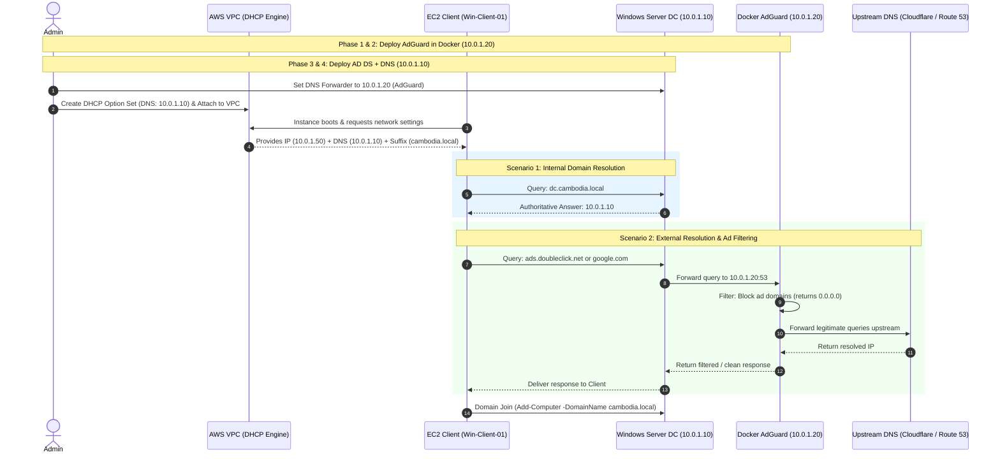

# Full Implementation Guide: Windows Active Directory, DNS & AdGuard Home (Docker) on AWS

This guide provides complete, production-grade instructions to build the end-to-end environment on AWS:
1. Setting up the AWS VPC and Subnets.
2. Launching and configuring an **AdGuard Home** container using Docker on Linux.
3. Deploying a Windows Server EC2 instance as an **Active Directory Domain Controller and DNS Server**.
4. Linking Windows DNS Forwarders to the AdGuard Home Docker instance (**Architecture A**).
5. Setting up **AWS VPC DHCP Option Sets** to automatically distribute the setup to client instances.
6. Verifying domain join, DNS resolution, and ad-filtering from a client machine.

---

## Architecture Flow Overview



---

## Phase 1: AWS VPC & Network Infrastructure Setup

### 1. Create the VPC
1. Open the **AWS VPC Console** > **Your VPCs** > **Create VPC**.
2. Settings:
   * **Name tag:** `lab-ad-vpc`
   * **IPv4 CIDR block:** `10.0.0.0/16`
3. Click **Create VPC**.

### 2. Create the Subnet
1. Go to **Subnets** > **Create subnet**.
2. Settings:
   * **VPC:** Select `lab-ad-vpc`
   * **Subnet name:** `lab-private-subnet-a`
   * **Availability Zone:** Choose any (e.g., `ap-southeast-1a`)
   * **IPv4 CIDR block:** `10.0.1.0/24`
3. Click **Create subnet**.

---

## Phase 2: Deploy AdGuard Home on Docker (Linux EC2)

### 1. Create AdGuard Security Group (`sg-adguard-docker`)
Create a Security Group with the following inbound rules:
* **Port 53 (UDP & TCP):** Source `10.0.1.10/32` (Only the Windows Domain Controller needs to send DNS queries here).
* **Port 3000 & 80 (TCP):** Source `My IP` (For web administrative dashboard access).
* **Port 22 (TCP):** Source `My IP` (SSH management).

### 2. Launch the Linux EC2 Instance
1. In the **EC2 Console**, launch an instance with **Amazon Linux 2023** or **Ubuntu 24.04 LTS**.
2. **Instance type:** `t3.micro` or `t3.small`.
3. Under **Network settings**:
   * **VPC:** `lab-ad-vpc`
   * **Subnet:** `lab-private-subnet-a`
   * **Primary IP (Static ENI):** Specify **`10.0.1.20`**.
   * **Security Group:** Select `sg-adguard-docker`.
4. Launch and connect via SSH.

### 3. Install Docker Compose and Deploy AdGuard Home

1. Connect to your Linux EC2 instance via SSH and install Docker with Docker Compose plugin:
```bash
# Update packages and install Docker
sudo dnf update -y
sudo dnf install -y docker git
sudo systemctl enable --now docker
sudo usermod -aG docker ec2-user

# Install Docker Compose Plugin (v2)
sudo mkdir -p /usr/local/lib/docker/cli-plugins
sudo curl -SL https://github.com/docker/compose/releases/latest/download/docker-compose-linux-x86_64 -o /usr/local/lib/docker/cli-plugins/docker-compose
sudo chmod +x /usr/local/lib/docker/cli-plugins/docker-compose

# Verify installation
docker compose version
```

2. Create a project directory for AdGuard Home:
```bash
mkdir -p ~/adguard && cd ~/adguard
mkdir -p work conf
```

3. Create the `docker-compose.yml` file (`~/adguard/docker-compose.yml`):
```yaml
services:
  adguardhome:
    image: adguard/adguardhome:latest
    container_name: adguard-home
    restart: unless-stopped
    volumes:
      - ./work:/opt/adguardhome/work
      - ./conf:/opt/adguardhome/conf
    ports:
      # Plain DNS (UDP & TCP)
      - "53:53/tcp"
      - "53:53/udp"
      # Initial setup wizard (port 3000) & Web GUI (port 80)
      - "3000:3000/tcp"
      - "80:80/tcp"
      # Optional: Encrypted DNS (DoT / DoH / QUIC) if needed later
      # - "443:443/tcp"
      # - "443:443/udp"
      # - "853:853/tcp"
      # - "853:853/udp"
      # - "784:784/udp"
    networks:
      - adguard-net

networks:
  adguard-net:
    driver: bridge
```

4. Start the AdGuard Home service:
```bash
docker compose up -d
```

5. Verify the container status:
```bash
docker compose ps
docker compose logs -f
```

### 4. Complete AdGuard Initial Setup Wizard
1. Open your browser and navigate to: `http://<Docker-Public-Or-Private-IP>:3000`
2. Follow the setup wizard:
   * **Admin Web Interface:** Set to listen on port `80` (or `3000`).
   * **DNS Server:** Set to listen on `0.0.0.0:53` (All interfaces).
   * Create your admin username and password.
3. Log into the AdGuard Dashboard:
   * Go to **Settings** > **DNS settings**.
   * Under **Upstream DNS servers**, specify your preferred public resolvers or AWS VPC resolver:
     ```text
     https://dns.cloudflare.com/dns-query
     1.1.1.1
     10.0.0.2
     ```
   * Click **Apply**.

---

## Phase 3: Launch & Promote Windows Domain Controller

### 1. Create Domain Controller Security Group (`sg-domain-controller`)
Add inbound rules for VPC traffic (Source: `10.0.0.0/16`):
* **DNS (UDP/TCP):** Port `53`
* **Kerberos (UDP/TCP):** Port `88`
* **LDAP (TCP/UDP):** Port `389`
* **SMB (TCP):** Port `445`
* **RPC Endpoint Mapper (TCP):** Port `135`
* **Dynamic RPC Ports (TCP):** Ports `49152 - 65535`
* **RDP (TCP 3389):** Restricted to your management IP.

### 2. Launch Windows Server EC2
1. Launch an EC2 instance with **Microsoft Windows Server 2022 Base**.
2. **Instance type:** `t3.medium`.
3. Under **Network settings**:
   * **VPC:** `lab-ad-vpc`
   * **Subnet:** `lab-private-subnet-a`
   * **Primary IP (Static ENI):** Specify **`10.0.1.10`**.
   * **Security Group:** Select `sg-domain-controller`.
4. Decrypt password and connect via RDP.

### 3. Install AD DS & DNS Roles and Promote to Domain Controller

You can install Active Directory and DNS using either the **Windows Server Manager GUI** or **PowerShell**:

#### Option A: Via Windows Server Manager GUI (Visual Method)

##### Step 3.1: Add AD DS and DNS Server Roles
1. Open **Server Manager** (from the Start Menu or Taskbar).
2. In the top-right corner, click **Manage** ➔ select **Add Roles and Features**.
3. **Before You Begin:** Click **Next**.
4. **Installation Type:** Select **Role-based or feature-based installation** ➔ Click **Next**.
5. **Server Selection:** Select your local server (`DC-Server-01` / `10.0.1.10`) ➔ Click **Next**.
6. **Server Roles:**
   * Check ✅ **Active Directory Domain Services** (Click **Add Features** in the pop-up).
   * Check ✅ **DNS Server** (Click **Add Features** in the pop-up).
   * Click **Next**.
7. **Features / AD DS / DNS Server:** Click **Next** through the informational screens.
8. **Confirmation:** Click **Install**. Wait for the installation bar to complete, then click **Close**.

##### Step 3.2: Promote the Server to a Domain Controller (GUI Wizard)
1. In **Server Manager**, click the **yellow warning flag icon** at the top-right notifications bar.
2. Click **"Promote this server to a domain controller"**.
3. **Deployment Configuration:**
   * Select **Add a new forest**.
   * **Root domain name:** Type `cambodia.local` (or `e6.local`).
   * Click **Next**.
4. **Domain Controller Options:**
   * Ensure ✅ **Domain Name System (DNS) server** and ✅ **Global Catalog (GC)** are checked.
   * Enter and confirm a **Directory Services Restore Mode (DSRM) password** (e.g., `P@ssw0rdLab2026!`).
   * Click **Next**.
5. **DNS Options:** Click **Next** (ignore the delegation warning; this is a new root forest).
6. **Additional Options:** Verify the **NetBIOS domain name** (`CAMBODIA`) ➔ Click **Next**.
7. **Paths:** Keep default database, log, and SYSVOL folders ➔ Click **Next**.
8. **Review Options & Prerequisites Check:**
   * Click **Next** and wait for the prerequisite validation to show a green checkmark (*"All prerequisite checks passed successfully"*).
   * Click **Install**.
9. *The server will automatically restart after promotion completes.*

---

#### Option B: Via PowerShell (Automated Method)
Open **PowerShell as Administrator** on the Windows Server:

```powershell
# 1. Install Windows Features
Install-WindowsFeature -Name AD-Domain-Services, DNS -IncludeManagementTools

# 2. Promote to new Forest / Domain Controller
$domainName = "cambodia.local"
$safeModePassword = ConvertTo-SecureString "P@ssw0rdLab2026!" -AsPlainText -Force

Install-ADDSForest `
    -DomainName $domainName `
    -DomainNetbiosName "CAMBODIA" `
    -InstallDns:$true `
    -SafeModeAdministratorPassword $safeModePassword `
    -Force:$true
```
*The server will reboot automatically.*

---

## Phase 4: Configure Windows DNS Forwarders & Zones (Pointing to AdGuard)

Once the Domain Controller restarts, log back into `DC-Server-01` via RDP using `CAMBODIA\Administrator`.

### 1. Configure DNS Forwarder to AdGuard (`10.0.1.20`)

#### Option A: Via Windows DNS Manager GUI (Visual Method)
1. Open **Server Manager** ➔ click **Tools** (top-right) ➔ select **DNS** (or press `Win + R`, type **`dnsmgmt.msc`**, and press **Enter**).
2. In the left console tree, right-click your server name (e.g., `DC-SERVER-01`) ➔ select **Properties**.
3. Go to the **Forwarders** tab.
4. Click the **Edit...** button.
5. Where it says *"Click here to add an IP address or DNS Name"*, type your AdGuard Docker host IP:
   * **`10.0.1.20`** and press **Enter**.
6. *(Optional)* If any other default forwarders (such as `10.0.0.2` or `8.8.8.8`) are listed, select them and click **Delete** so all external traffic is strictly filtered by AdGuard.
7. Click **OK** ➔ Click **Apply** ➔ Click **OK**.

#### Option B: Via PowerShell
```powershell
# Remove existing forwarders and set AdGuard IP as primary forwarder
Set-DnsServerForwarder -IPAddress 10.0.1.20 -PassThru
```

---

### 2. Create Custom Forward Lookup Zone & Host (A) Records (Optional Lab Zone)

If you want to host an additional zone like `cambodia.com` and `web.cambodia.com` (just like in your VMware lab):

#### Option A: Via Windows DNS Manager GUI (Visual Method)
1. Open **DNS Manager** (`dnsmgmt.msc`).
2. Expand your server name ➔ right-click **Forward Lookup Zones** ➔ select **New Zone...**.
3. **New Zone Wizard:**
   * Click **Next**.
   * **Zone Type:** Select **Primary zone** (Keep *"Store the zone in Active Directory"* checked) ➔ Click **Next**.
   * **Active Directory Zone Replication Scope:** Select *To all DNS servers running on domain controllers in this domain* ➔ Click **Next**.
   * **Zone Name:** Type **`cambodia.com`** ➔ Click **Next**.
   * **Dynamic Update:** Select **Allow only secure dynamic updates (recommended for Active Directory)** ➔ Click **Next** ➔ Click **Finish**.
4. **Create the `web` Host (A) Record:**
   * In the left tree under *Forward Lookup Zones*, click on **`cambodia.com`**.
   * Right-click inside the right pane (or right-click `cambodia.com`) ➔ select **New Host (A or AAAA)...**.
   * **Name:** Type `web` (Notice the FQDN previews as `web.cambodia.com.`).
   * **IP address:** Type `10.0.1.10` (or your web server's IP).
   * Click **Add Host** ➔ Click **OK** ➔ Click **Done**.

#### Option B: Via PowerShell
```powershell
# Create AD-Integrated Primary Zone 'cambodia.com'
Add-DnsServerPrimaryZone -Name "cambodia.com" -ReplicationScope "Domain" -PassThru

# Add Host (A) record 'web.cambodia.com' -> 10.0.1.10
Add-DnsServerResourceRecordA -ZoneName "cambodia.com" -Name "web" -IPv4Address "10.0.1.10"
```

---

## Phase 5: Configure AWS VPC DHCP Option Sets

We now instruct AWS VPC to tell all member EC2 instances that their primary DNS is `10.0.1.10` (Windows DC):

1. Go to the **AWS VPC Console** > **DHCP option sets** > **Create DHCP option set**.
2. Configure:
   * **Name tag:** `dopt-cambodia-adguard`
   * **Domain name:** `cambodia.local`
   * **Domain name servers:** `10.0.1.10`
3. Click **Create DHCP option set**.
4. Attach to the VPC:
   * Go to **Your VPCs** > Select `lab-ad-vpc`.
   * Click **Actions** > **Edit VPC settings** (or **Edit DHCP option set**).
   * Change DHCP option set to `dopt-cambodia-adguard`.
   * Click **Save**.

---

## Phase 6: Client Verification & Domain Join

### 1. Launch a Member Client Instance
* Launch a Windows 10/11 or Windows Server instance (`Win-Client-01`) in `lab-private-subnet-a`.
* Leave its network adapter set to default **Obtain an IP address automatically** and **Obtain DNS server address automatically**.

### 2. Verify Network Leases on Client

#### Option A: Via Windows GUI (`ncpa.cpl`)
1. Press `Win + R`, type **`ncpa.cpl`**, and press **Enter**.
2. Double-click **Ethernet** (or right-click ➔ **Status**).
3. Click the **Details...** button.
4. Verify:
   * **DHCP Enabled:** `Yes`
   * **IPv4 Address:** `10.0.1.x` (Assigned by AWS VPC)
   * **Connection-specific DNS Suffix:** `cambodia.local`
   * **IPv4 DNS Server:** `10.0.1.10`

#### Option B: Via Command Prompt / PowerShell
```powershell
ipconfig /all
```

---

### 3. Verify DNS and Ad-Filtering
Open PowerShell or Command Prompt on the client and run:

```powershell
# Test 1: Internal Active Directory Resolution
nslookup dc-server-01.cambodia.local
# Expected: Returns 10.0.1.10 from Windows DNS

# Test 2: Custom Zone Resolution
nslookup web.cambodia.com
# Expected: Returns 10.0.1.10 from Windows DNS

# Test 3: External Web Resolution
nslookup google.com
# Expected: Resolves public IP via AdGuard -> Upstream

# Test 4: Ad-block Filtering Test
nslookup doubleclick.net
# Expected: Resolves to 0.0.0.0 (Blocked by AdGuard!)
```

Check your **AdGuard Web Dashboard** (`http://10.0.1.20`). You will see query statistics reflecting the forwarded requests from Windows Server.

---

### 4. Join the Client to the Active Directory Domain

#### Option A: Via Windows System Properties GUI (Visual Method)
1. Press `Win + R`, type **`sysdm.cpl`**, and press **Enter** (this opens **System Properties**).
2. Under the **Computer Name** tab, click the **Change...** button.
3. Under **Member of**, select **Domain:** and type:
   * **`cambodia.local`**
4. Click **OK**.
5. A **Windows Security** credential prompt will appear:
   * **User name:** `CAMBODIA\Administrator`
   * **Password:** *(Enter your Domain Administrator password)*
   * Click **OK**.
6. Wait a few seconds for the welcome message: *"Welcome to the cambodia.local domain."*
7. Click **OK** ➔ Click **OK** ➔ Click **Close** ➔ Click **Restart Now**.

#### Option B: Via PowerShell (Automated Method)
```powershell
Add-Computer -DomainName "cambodia.local" -Credential (Get-Credential) -Restart
```
Enter `cambodia\Administrator` and its password. The client machine will join the domain and restart automatically.
